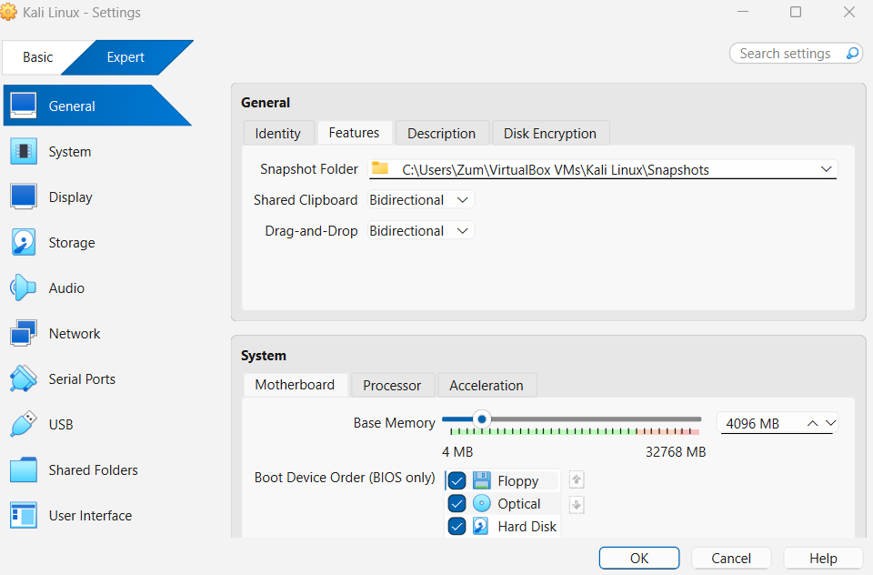
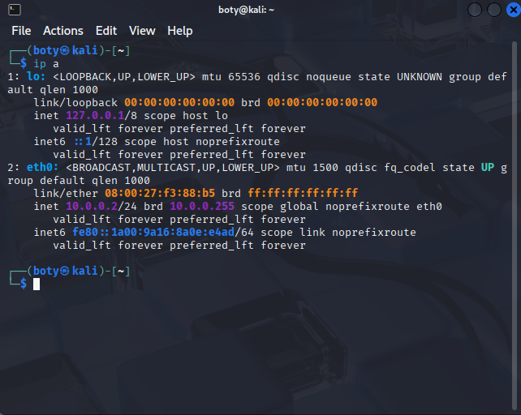
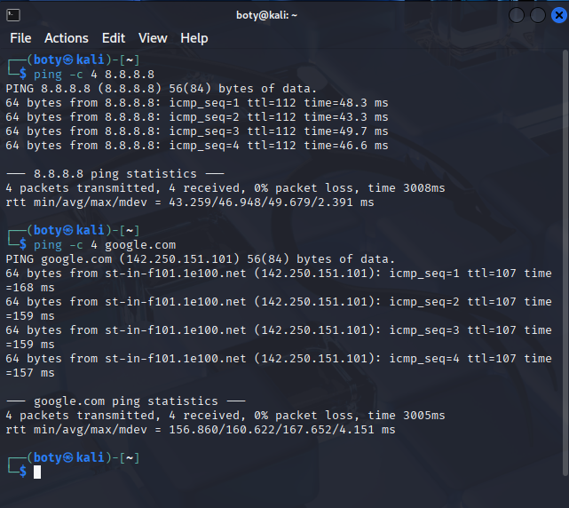
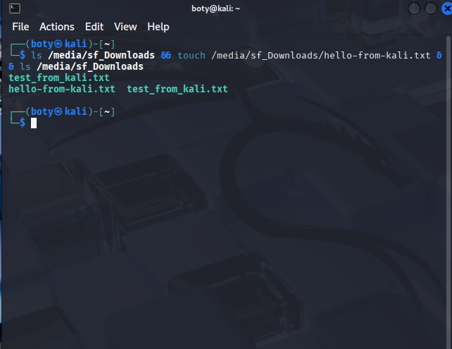

# Project Title: Lab Setup - Deploy Virtual Machines
## Project Supervisor: Mr. Waqas Karim (CCIE)
### Prepared By: OLASUMBO B084 - Week 1 PM1

## 1. Project Overview
Virtual machines play a vital role in modern computing by providing isolated environments. This lab focuses on deploying Kali Linux on VirtualBox with NAT networking, clipboard sharing and shared folders for cybersecurity practice.

## 2. Project Goals
- Install VirtualBox Hypervisor
- Setup Kali Linux VM with NAT IP 10.0.0.2
- Configure internet access, clipboard, and shared folder
- Take snapshot for rollback

## 3. Lab Design
- Hypervisor: VirtualBox (free, easy to use)
- VM: Kali Linux
- Network: NAT (10.0.0.2/24)
- Shared Folder: C:\Users\Zum\Desktop\Downloads -> /media/sf_Downloads

## 4. Implementation Steps with Evidence

### Step 1 - VM General Settings - Clipboard & DragDrop Bidirectional

### Step 2 - Shared Folder Configuration - Downloads Full Access Auto-mount

### Step 3 - Verify IP Address 10.0.0.2
Command: `ip a`

### Step 4 - Verify Internet Access
Commands: `ping -c 4 8.8.8.8` and `ping -c 4 google.com` - 0% loss

### Step 5 - Verify Shared Folder
Command: `ls /media/sf_Downloads && touch /media/sf_Downloads/proof-from-kali.txt`

### Step 6 - Snapshot 10.0.0.2-configured

## 5. Learning Outcome
Successfully deployed cybersecurity lab with NAT networking, verified internet connectivity, and enabled host-guest file sharing for future tools transfer.

GitHub Repo: [Your Link Here]
