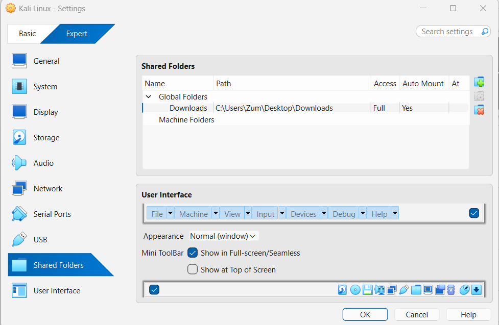
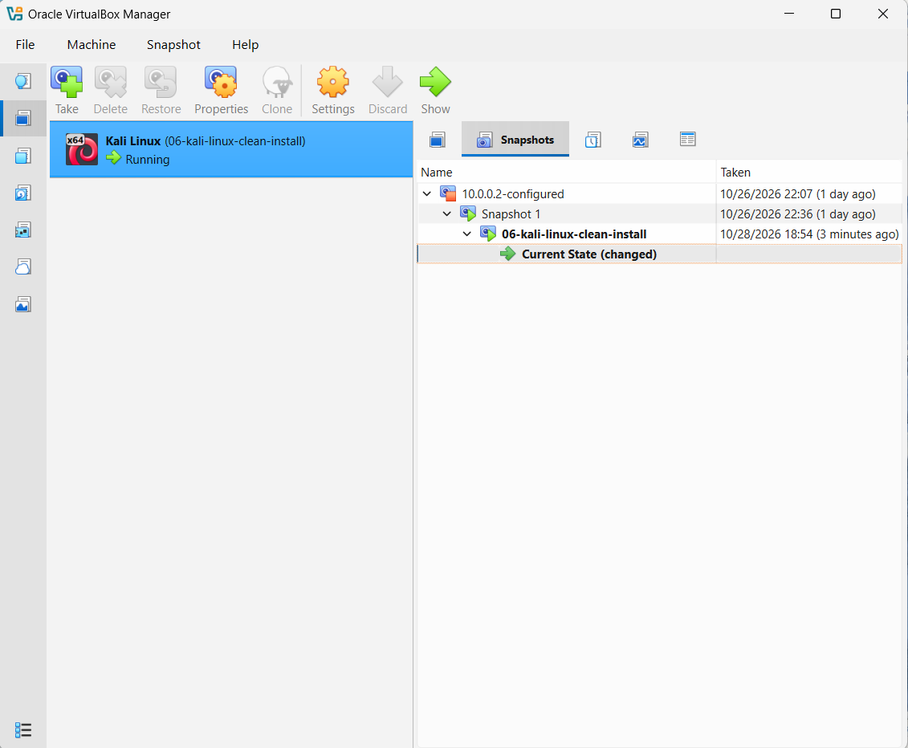

# NETWORKWALKS-OLASUMBO-B084-WK1-PM1-CYBERSECURITY-LAB-SETUP

### Week 1 Cybersecurity Lab Setup - Kali Linux VM on VirtualBox with NAT 10.0.0.2

### Project Title: Lab Setup - Deploy Virtual Environment

#### Lab Tasks Screenshots

**01 - Clipboard / Drag & Drop Enabled**

**02 - Shared Folder Configuration**

**03 - IP Address Verification (10.0.0.2)**

**04 - Internet Connectivity Ping Test**

**05 - Shared Folder Access Verification**

**06 - Kali Linux Clean Install Snapshot**

